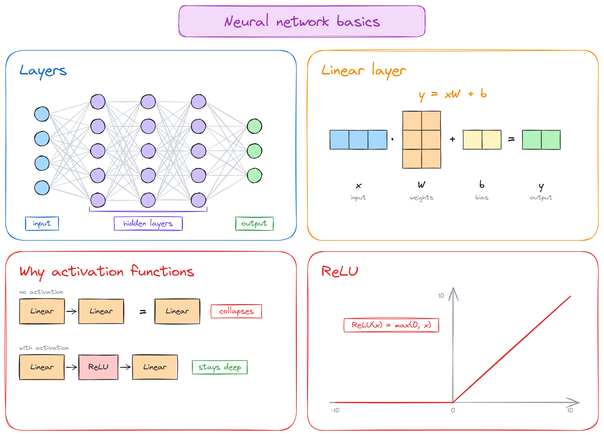
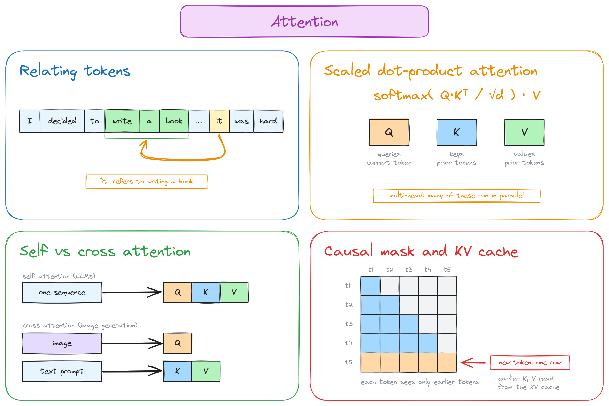
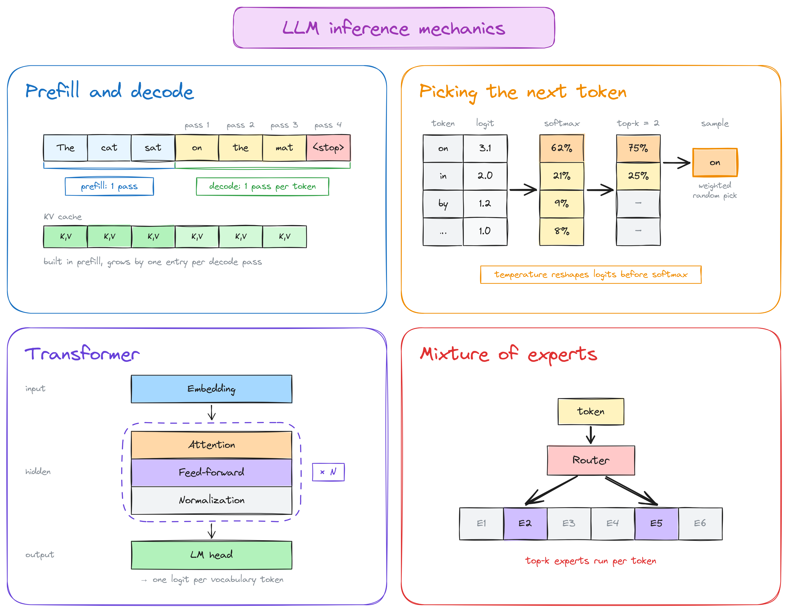
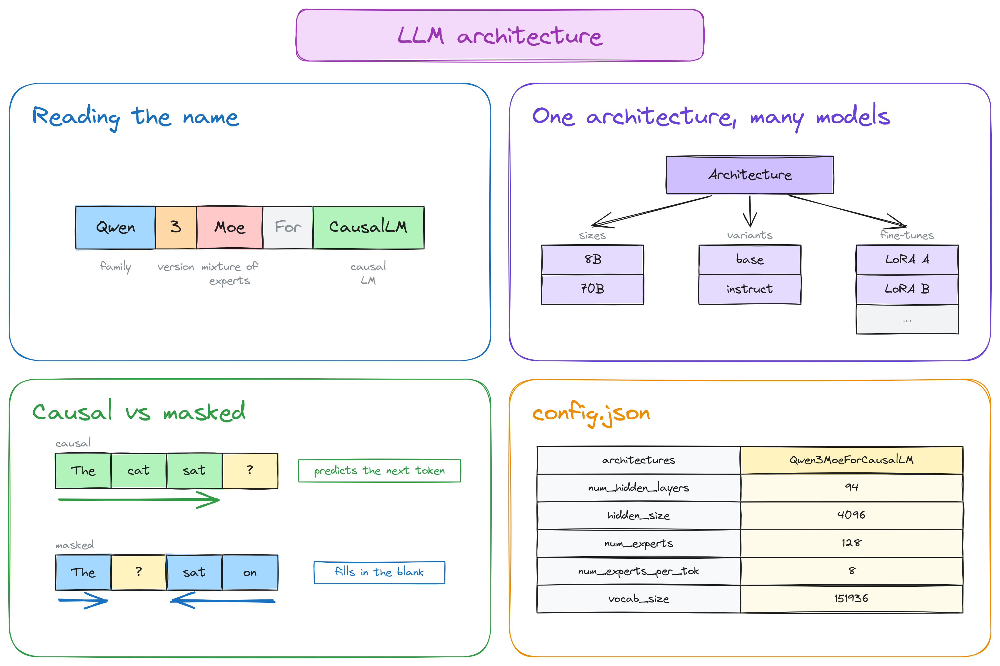
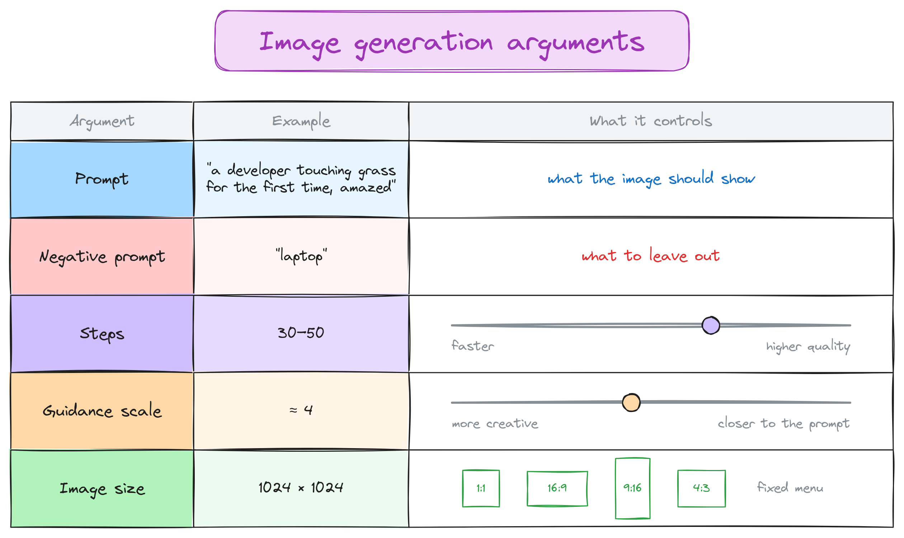
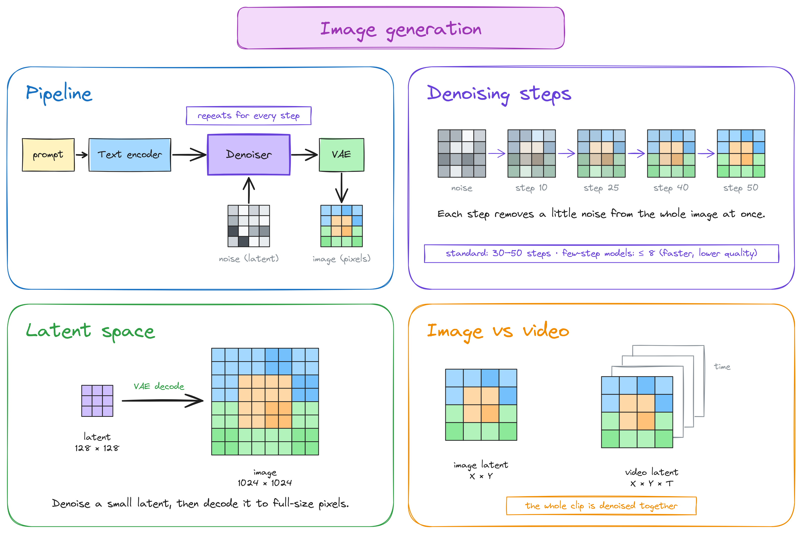
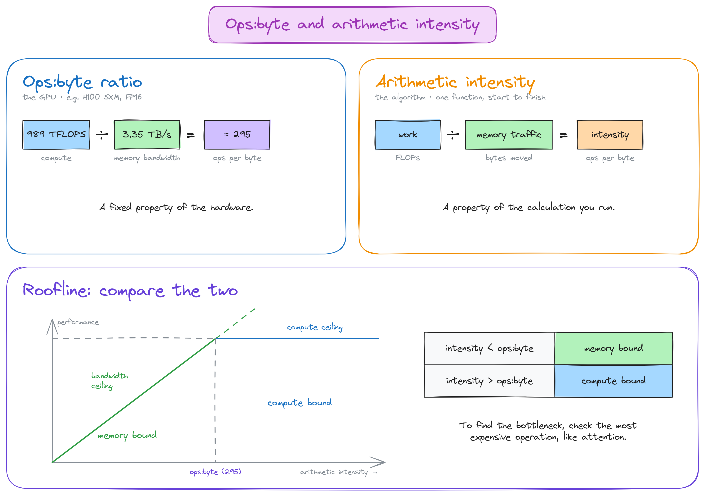
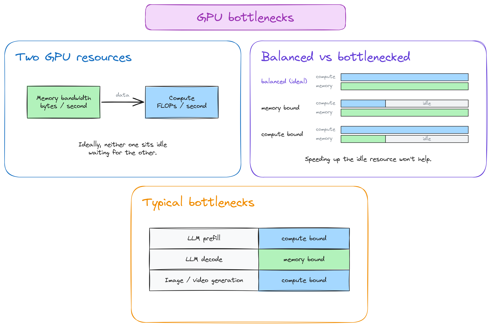
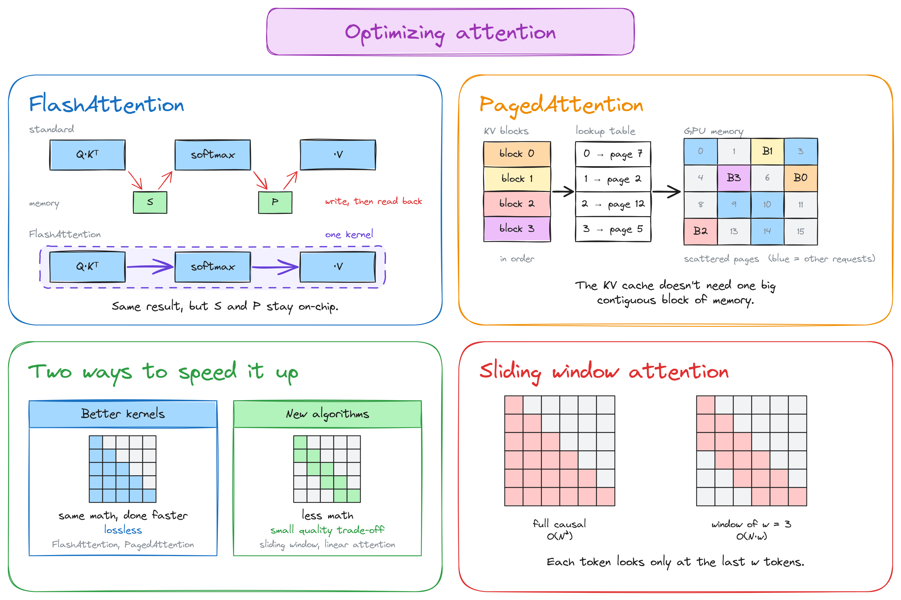

# 100 days of Inference Engineering

### Day 1

- today i read chapter 0 of Inference Engineering. some of the learnings below:

- apparently we have time... inference engineering is still in its infancy. huge potential, still a young field. used to be a pretty niche field (around 3 years ago).

- the book explained a trend starting around 2024 when open models started to catch up with the frontier. you might remember deepseek v3 and r1 crashing ai stocks :)

- since open models are becoming better and better, "many" companies are actively swapping out closed models and fine-tuning open ones for domain specific tasks.

- a production "ready" inference stack have both runtime and infrastructure optimizations, also tools for helping developers deal with the complexity and stay productive...

    

    

### Day 2

- today i read chapter 1 of Inference Engineering. compared to yesterday chapter there is a lot of important stuff on this one, i tried my best to extract the main points. 

- there is not one fit all for inference, an inference services must be specialized for the demands of their workloads. thus it's important to know: model requirements, app. interface, latency budgets, unit economics and usage patterns.

    

- there are two ways to add ai to your app: shared inference or dedicated deployment.

    

- if you're building ai product and you have no idea of your workload will be, start with pay-per-token API, something like OpenRouter (shared inference). 

- one of the most important decisions is which model you choose to work with. smaller models tend to be cheaper and faster to run. so before you go all crazy on speculative decoding keep that in mind... check if a smaller model can get the job done.

- on evals, the book mentioned the ongoing industry benchmark-maxxing that is going on and how those tests are being gamed to make a model looks good... also on the importance of having application evals tailor to your app. the latter is a must have!

- the book defines fine-tuning as taking a foundation model and re-targeting it to different use case. fine-tuning benefits from tasks when the scope is small, for example text2sql. important fine-tuning does not changes the model architecture only the weights.

- destillation on the otherhand preserves the behavior of a large model in a smaller, more efficient model, and thus changes the architecture. 

- learned a bunch of metrics: time to first token (TTFT), perceived and total tokens per second (TPS), iter-token latency (ITL), also the important of consider latency percentiles while measuring those.

    

### Day 3

- today i read chapter 2 of Inference Engineering. there's a lot to cover, so i'm splitting this chapter into two posts. one today and one tomorrow. that way i can keep the post in a "manageable" size without leaving too much content out.

- the chapter starts with a high-level intro to neural networks in section 2.1. some of it was familiar, but still a good refresher... section 2.2 then builds on that with the basics of inference, attention, and MoE.

- transfomers have become the foundation of generative AI. as you might know there are not exclusive to LLMs, they power every modality: voice, image, video, etc. 

- two important transformer-based models: autoregressive token generation and iterative denoising.

- neural networks have nodes (neurons). a group of nodes is called a layer. there are three types of layers: input layer, hidden layer, and output layer.

- the book explains matmul is a core operation for linear layers, and why stacking linear layers alone collapses into a single layer with all matrices combined together.

- activations like ReLU add nonlinearity so the network can learn more complex patterns. basically break linearity to allow for multi-layer neural networks.

- as you probably heard by now, LLMs typically produce tokens autoregressively. this means they produce new tokens one at a time based on every previous token.

    

- the book explained the two phases of inference: prefill and decode. in prefill we process the prompt and cache its keys and values. decode then uses that cache to generate tokens one at a time.

- the inference process can be nudged by configuration arguments such as: temperature, top-k and top-p.

- there are two main types of attention: self-attention and cross-attention. self-attention is when tokens pay attention to other tokens in the same sequence (that's what happens in LLMs). cross-attention is when one sequence pays attention to another, like image features looking at a text prompt while generating an image.

    

- the book also explains mixture of experts (MoE) architecture optimization. the idea is that inside the neural network, some layers have several smaller networks called "experts". when generating an answer a router picks just a few of those experts to process each token. that way, the model can have more parameters without using all of them for every token, which saves computation. 

- you may have seen this in some qwen model names, for example: Qwen3-235B-A22B. here A22B means 22B active parameters per token, out of 235B total parameters.

    

    

### Day 4

- yesterday we read chapter 2 but we couldn't fit everything into the Day 3 post, so here are the missing notes.

- text-to-image models take a text prompt and create an image from it.

- these models usually work as pipelines made up of multiple models.

- those pipelines typically have three essential components.

- the first is a text encoder, which turn the prompt into an internal representation the model can understand.

- the second is the denoising model, which is kind of the meat of the whole process, because it starts with random noise in latent space and gradually refines it based on the input prompt.

- the third is the variational autoencoder (VAE), whose decoder converts the result from latent space back into pixel space.

- if you're wondering what latent space is, think of it as a compressed representation of the data, in this case the image. images usually have a lot of pixels... which can add extra computation, so using latent space helps avoid that overhead.

- most of the time in this pipeline goes into denoising. few-step models can reduce the number of steps to generate images faster, but at the cost of losing some output quality. 

- image generation is usually controlled with several parameters, such as prompt, negative prompt, number of steps, guidance scale, and image size.

    

- the mentioned stable diffusion xl (SDXL) as an example. it came out in 2023, but newer models like qwen image still follow a similar pipeline.

- video generation works in a similar way, but with a sequence of frames instead of a single image.

- many video diffusion models process a whole clip in latent space, so longer clips need more memory and compute. that's one reason many video generation tools only let you generate short clips at a time.

    

- metrics like ops:byte ratio and arithmetic intensity, together with the roofline model, are really helpful to figure out whether our program is memory bound or compute bound.

    

    

- "normal" attention has quadratic compute cost during prefill, which can make long prompts expensive to process...

- there are two main ways to speed attention. first, improve the implementation without changing the attention computation, like flash attention and paged attention, or change the algorithm to scale better at a possible cost to quality... like sliding window attention, linear attention or replacing attention with state-space models like mamba.

    
