# 100 days of Inference Engineering

### Day 1

- today i read chapter 0 of Inference Engineering. some of the learnings below:

- apparently we have time... inference engineering is still in its infancy. huge potential, still a young field. used to be a pretty niche field (around 3 years ago).

- the book explained a trend starting around 2024 when open models started to catch up with the frontier. you might remember deepseek v3 and r1 crashing ai stocks :)

- since open models are becoming better and better, "many" companies are actively swapping out closed models and fine-tuning open ones for domain specific tasks.

- a production "ready" inference stack have both runtime and infrastructure optimizations, also tools for helping developers deal with the complexity and stay productive...

    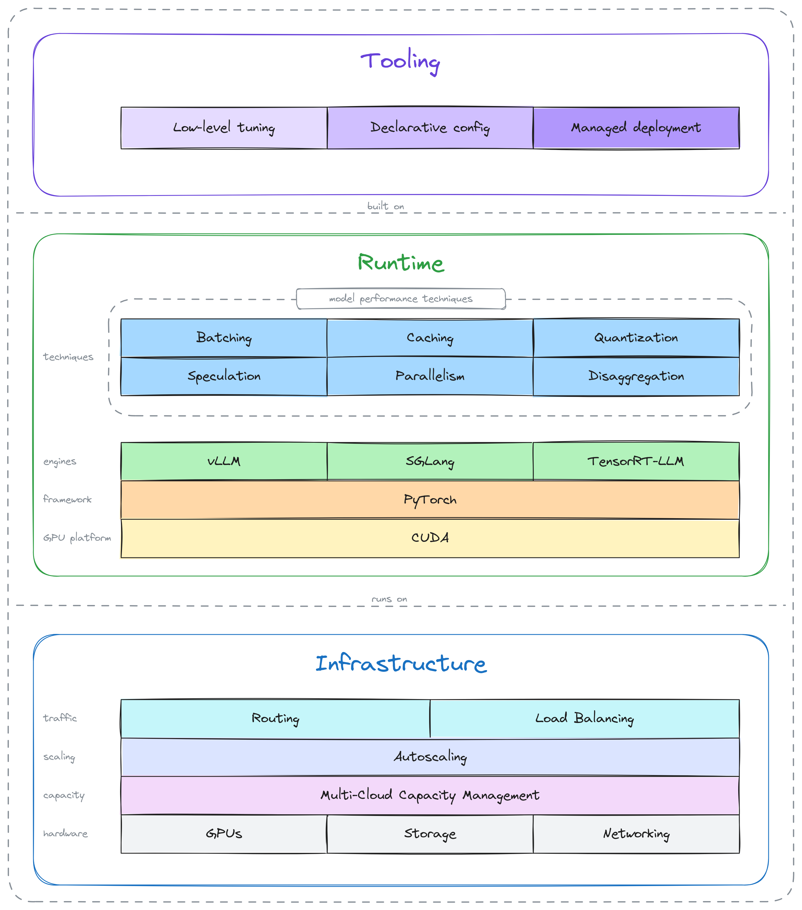

    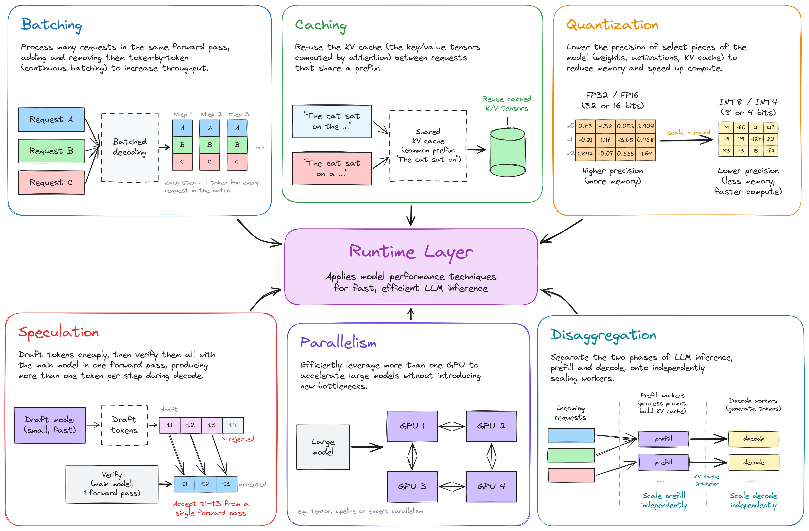

### Day 2

- today i read chapter 1 of Inference Engineering. compared to yesterday chapter there is a lot of important stuff on this one, i tried my best to extract the main points. 

- there is not one fit all for inference, an inference services must be specialized for the demands of their workloads. thus it's important to know: model requirements, app. interface, latency budgets, unit economics and usage patterns.

    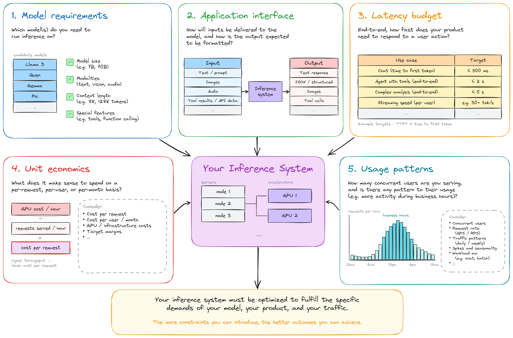

- there are two ways to add ai to your app: shared inference or dedicated deployment.

    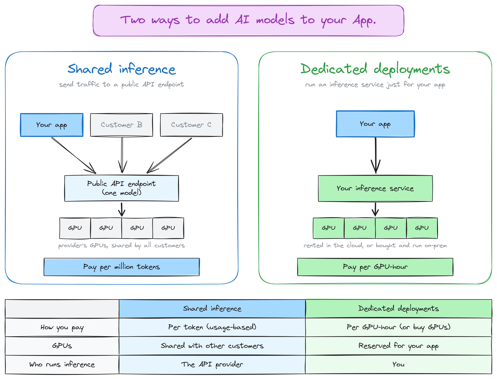

- if you're building ai product and you have no idea of your workload will be, start with pay-per-token API, something like OpenRouter (shared inference). 

- one of the most important decisions is which model you choose to work with. smaller models tend to be cheaper and faster to run. so before you go all crazy on speculative decoding keep that in mind... check if a smaller model can get the job done.

- on evals, the book mentioned the ongoing industry benchmark-maxxing that is going on and how those tests are being gamed to make a model looks good... also on the importance of having application evals tailor to your app. the latter is a must have!

- the book defines fine-tuning as taking a foundation model and re-targeting it to different use case. fine-tuning benefits from tasks when the scope is small, for example text2sql. important fine-tuning does not changes the model architecture only the weights.

- destillation on the otherhand preserves the behavior of a large model in a smaller, more efficient model, and thus changes the architecture. 

- learned a bunch of metrics: time to first token (TTFT), perceived and total tokens per second (TPS), iter-token latency (ITL), also the important of consider latency percentiles while measuring those.

    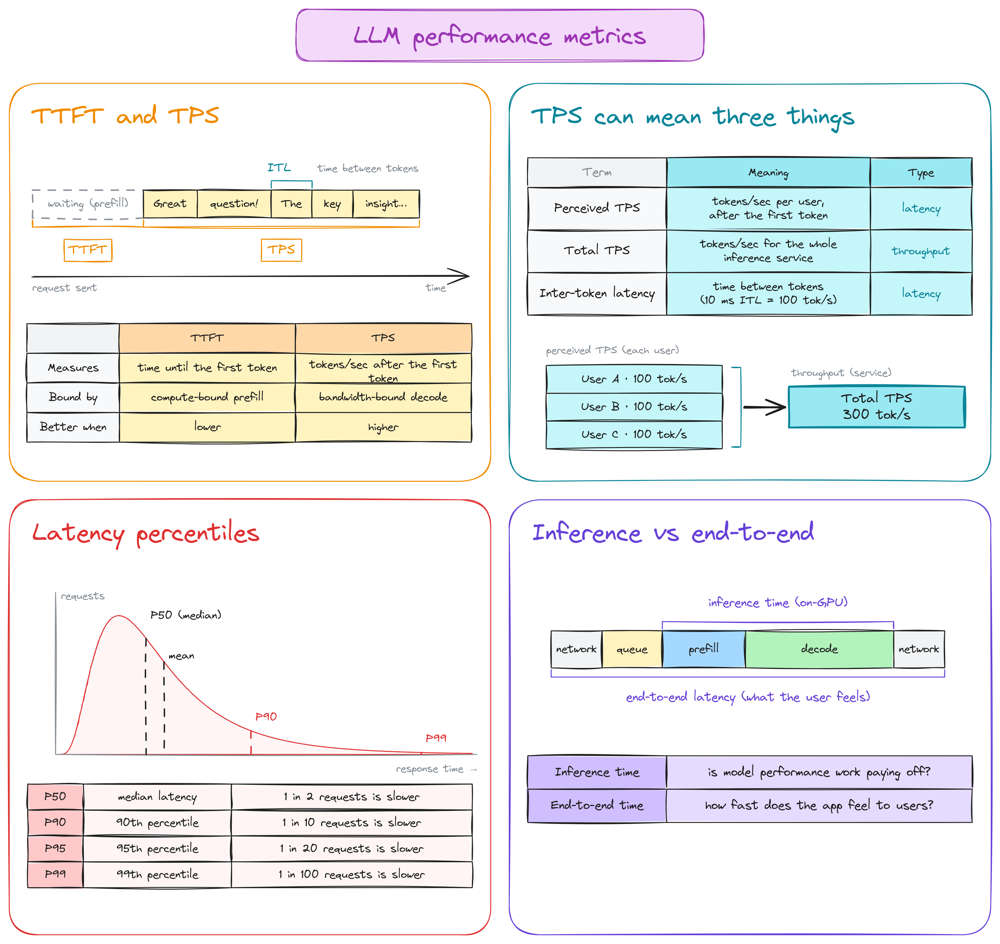


### Day 3

- today i read chapter 2 of Inference Engineering. there's a lot to cover, so i'm splitting this chapter into two posts. one today and one tomorrow. that way i can keep the post in a "manageable" size without leaving too much content out.

- the chapter starts with a high-level intro to neural networks in section 2.1. some of it was familiar, but still a good refresher... section 2.2 then builds on that with the basics of inference, attention, and MoE.

- transfomers have become the foundation of generative AI. as you might know there are not exclusive to LLMs, they power every modality: voice, image, video, etc. 

- two important transformer-based models: autoregressive token generation and iterative denoising.

- neural networks have nodes (neurons). a group of nodes is called a layer. there are three types of layers: input layer, hidden layer, and output layer.

- the book explains matmul is a core operation for linear layers, and why stacking linear layers alone collapses into a single layer with all matrices combined together.

- activations like ReLU add nonlinearity so the network can learn more complex patterns. basically break linearity to allow for multi-layer neural networks.

- as you probably heard by now, LLMs typically produce tokens autoregressively. this means they produce new tokens one at a time based on every previous token.

    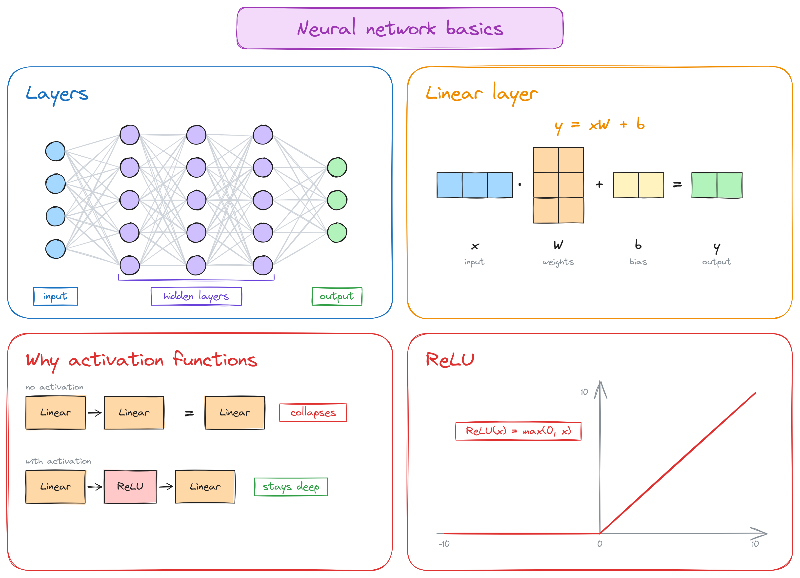

- the book explained the two phases of inference: prefill and decode. in prefill we process the prompt and cache its keys and values. decode then uses that cache to generate tokens one at a time.

- the inference process can be nudged by configuration arguments such as: temperature, top-k and top-p.

- there are two main types of attention: self-attention and cross-attention. self-attention is when tokens pay attention to other tokens in the same sequence (that's what happens in LLMs). cross-attention is when one sequence pays attention to another, like image features looking at a text prompt while generating an image.

    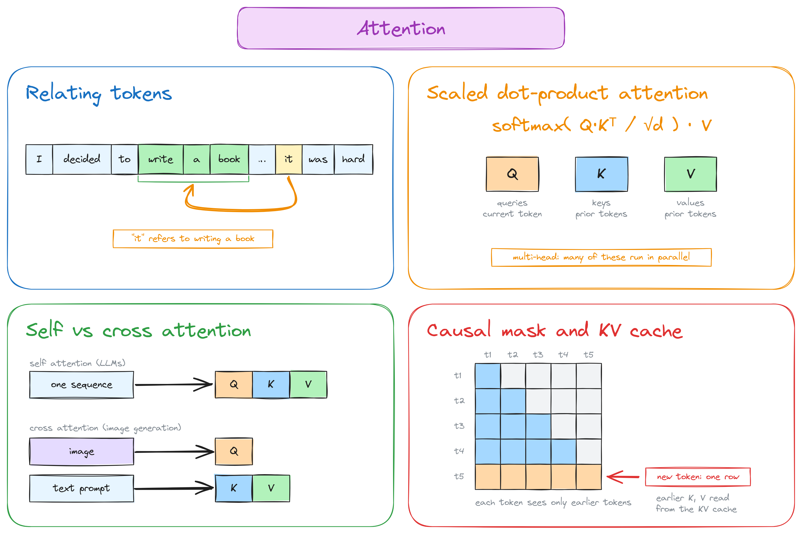

- the book also explains mixture of experts (MoE) architecture optimization. the idea is that inside the neural network, some layers have several smaller networks called "experts". when generating an answer a router picks just a few of those experts to process each token. that way, the model can have more parameters without using all of them for every token, which saves computation. 

- you may have seen this in some qwen model names, for example: Qwen3-235B-A22B. here A22B means 22B active parameters per token, out of 235B total parameters.

    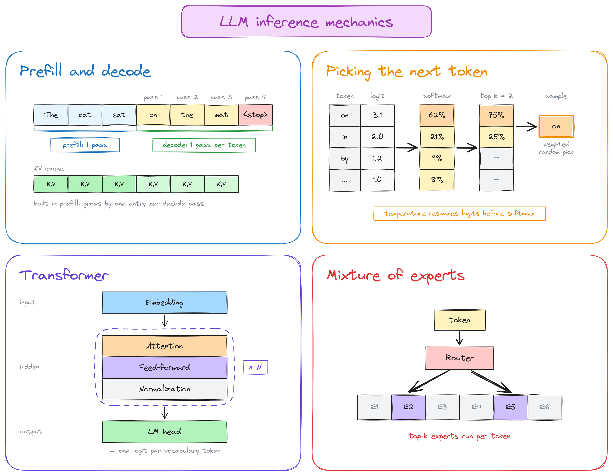

    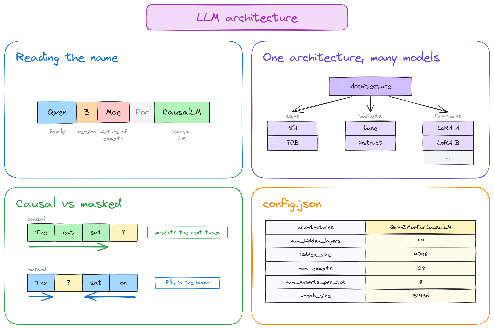

### Day 4

- yesterday we read chapter 2 but we couldn't fit everything into the Day 3 post, so here are the missing notes.

- text-to-image models take a text prompt and create an image from it.

- these models usually work as pipelines made up of multiple models.

- those pipelines typically have three essential components.

- the first is a text encoder, which turn the prompt into an internal representation the model can understand.

- the second is the denoising model, which is kind of the meat of the whole process, because it starts with random noise in latent space and gradually refines it based on the input prompt.

- the third is the variational autoencoder (VAE), whose decoder converts the result from latent space back into pixel space.

- if you're wondering what latent space is, think of it as a compressed representation of the data, in this case the image. images usually have a lot of pixels... which can add extra computation, so using latent space helps avoid that overhead.

- most of the time in this pipeline goes into denoising. few-step models can reduce the number of steps to generate images faster, but at the cost of losing some output quality. 

- image generation is usually controlled with several parameters, such as prompt, negative prompt, number of steps, guidance scale, and image size.

    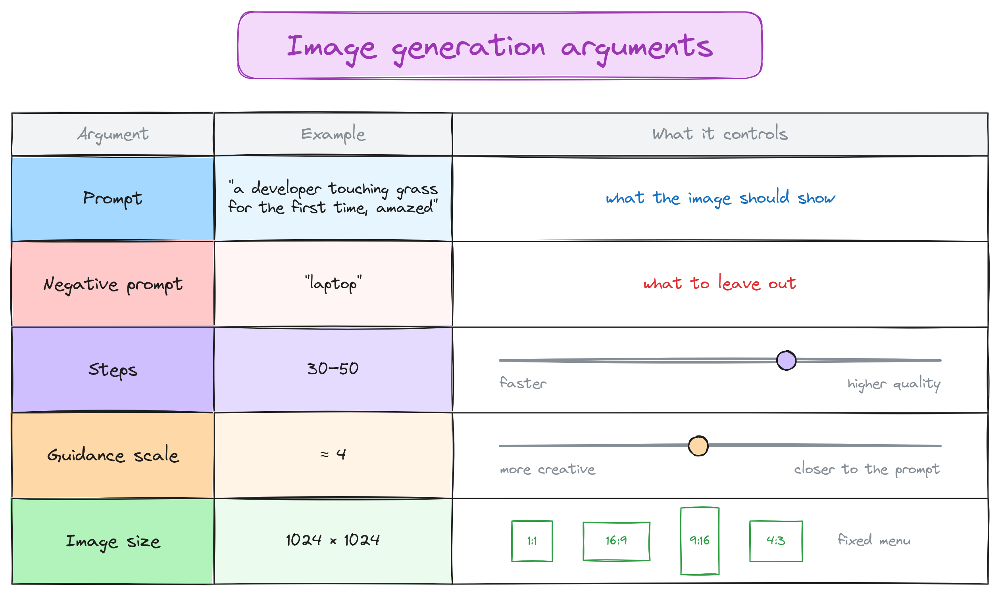

- video generation works in a similar way, but with a sequence of frames instead of a single image.

- many video diffusion models process a whole clip in latent space, so longer clips need more memory and compute. that's one reason many video generation tools only let you generate short clips at a time.

    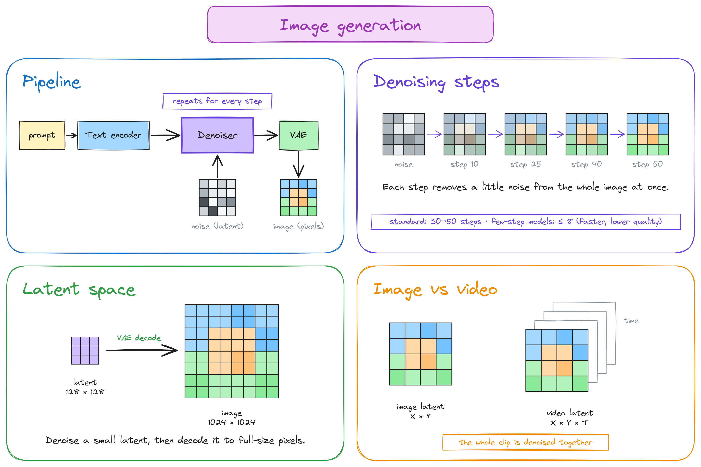

- metrics like ops:byte ratio and arithmetic intensity, together with the roofline model, are really helpful to figure out whether our program is memory bound or compute bound.

    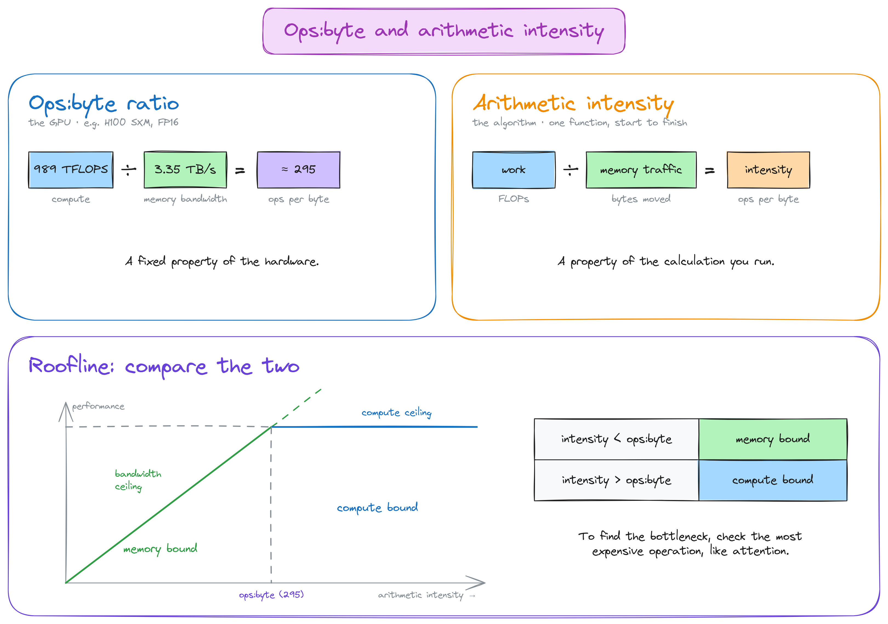

    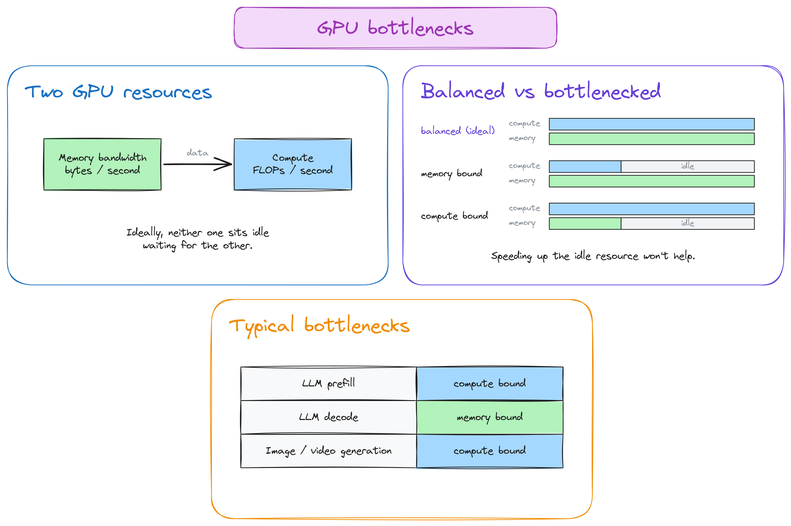

- "normal" attention has quadratic compute cost during prefill, which can make long prompts expensive to process...

- there are two main ways to speed attention. first, improve the implementation without changing the attention computation, like flash attention and paged attention, or change the algorithm to scale better at a possible cost to quality... like sliding window attention, linear attention or replacing attention with state-space models like mamba.

    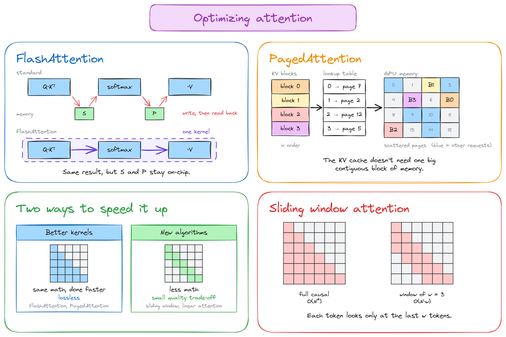

### Day 5

- today i read chapter 3 of Inference Engineering. this chapter is all about hardware! 

- three types of gpus in the market. data center gpus (B200), workstation gpus (NVIDIA RTX Pro 6000), personal computing gpus (NVIDIA GeForce RTX 5090).

- it is not hard to guess that data center gpus offer the highest performance, but they really shine when it comes to high-bandwidth gpu-to-gpu interconnection.

    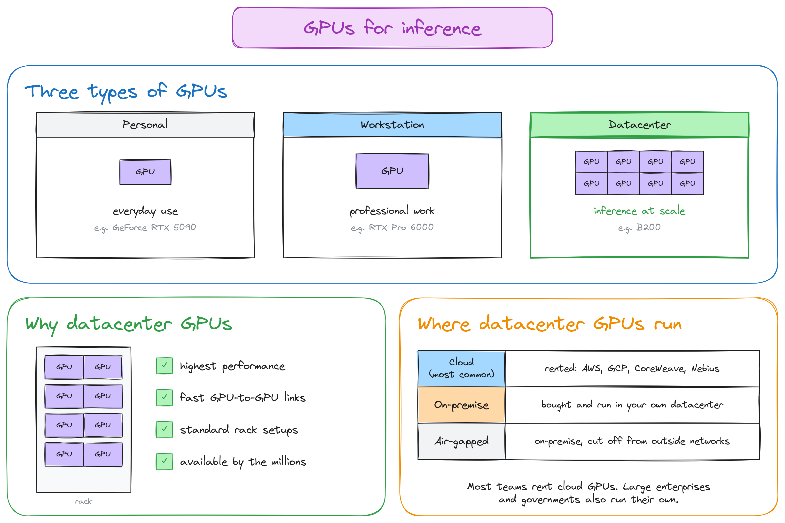

- the book showcases the main differences between cpus and gpus. basically gpus are optimized for throughput, while cpus for latency.

- in gpus the term "core" have a different meaning than in cpus. here could be either: cuda cores (scalars), tensor cores (matrices), sfus (sin, cos, log).

- as an inference engineer, it helps to have a strong mental model of what is going on in the gpu.

- compute is measured in flops (floating point operations per second). spec sheet often mentioned two measurements for tensor core compute: dense and sparse.

- dense is the raw floating-point ops/sec.

- sparse is for tensors where half of the values are 0, and tensor cores can skip multiplication by 0.

- compute is the bottleneck for llm prefill and for image/video generation. if you are selecting hardware, keep that in mind. memory bandwidth is the bottleneck for llm decode, so if you pick a gpu and want to generate more tok/sec, select the one with higher memory bandwidth.

- the "v" in vram stands for "video", and that is related to the original usage of gpus.

- vram for datacenter gpus usually comes in the form of hbm3, hbm3e or hbm4.

- in gpus, we can also find static ram (sram), which is an on-chip memory usually in the kb to mb range.

    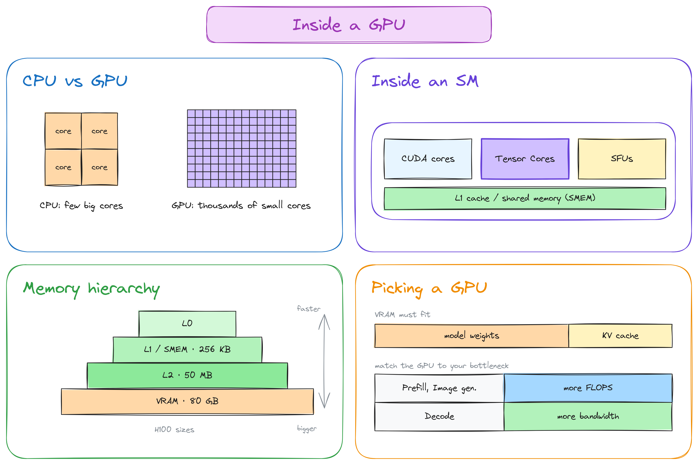

- if you compare it with software, hardware interactions are slow. shipping gpus involves building something in the "real" world.

- gpu names have two parts `letter - number`, for example B200, H100, etc. the letter is the architecture generation, and those are usually inspired by scientist names, for example blackwell is named after mathematician david blackwell. the number is used to identify the particular model within the generation.

- nvidia releases a new gpu architecture every one to two years.

- rubin is the next architecture from nvidia, and after that feynman.

- nvidia is also going into cpus with "grace". the major advantage of grace is a much higher-bandwidth connection between cpu and gpu.

    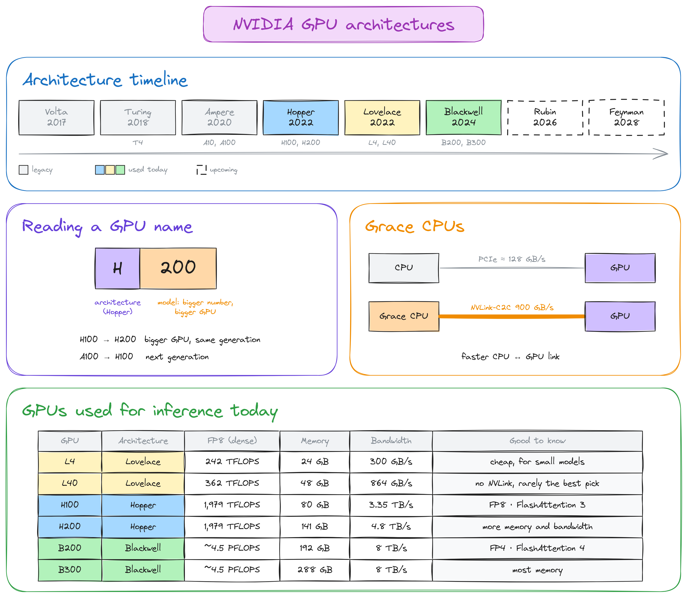

- the atomic unit for gpu allocation in the cloud is the "instance".

- basically, an instance is a fancy word for a "virtual machine" that bundles together gpus, cpus, memory, storage, networking, and interconnect.

- by interconnect, i mean the physical gpu-to-gpu and node-to-node connections that let you run multiple gpus at once.

- usually, models are too big to run on a single gpu, and it is not rare to need between 2-8 (even more) gpus to run a large model like deepseek.

- for those connections, gpus can be connected via two systems: NVLink (one-to-one) or NVSwitch (all-to-all).

- for node-to-node communication, the standard for nvidia gpus is infiniband, which competes with ethernet.

- sometimes you run into the opposite problem, where the gpu is too big for the model. so instead of falling back to older gpus, you can use multi-instance gpu, which helps you split a gpu into multiple slices.

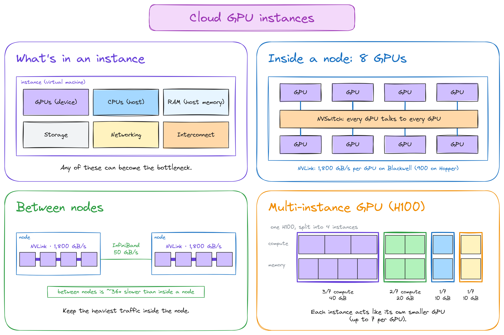

- finally, the book also touches briefly on local inference and its advantages: zero network latency, independence, privacy, and cost.

- some of the disadvantages include hardware capabilities, thermal constraints, fragmented support, and battery life.

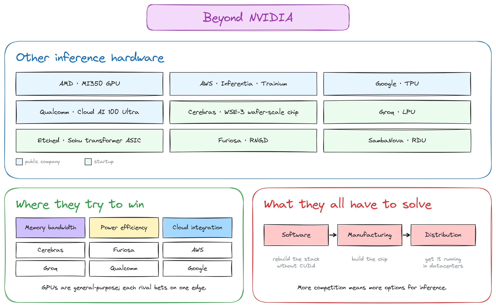

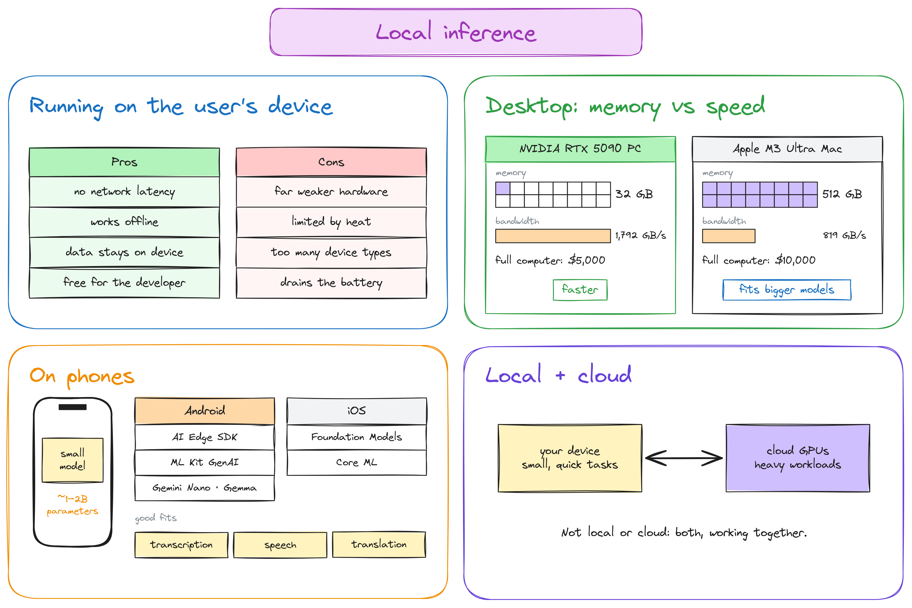

### Day 6

- today i read chapter 4 of Inference Engineering. this chapter is about software, and is a bit too long... i'm splitting it up. here is the first half:

- nvidia is basically the king of the jungle in the inference space.

- some of the key players in the space are nvidia (CUDA, Dynamo), hugging face (transformers, diffusers), the linux foundation (PyTorch, vLLM), and lmsys org (SGLang).

    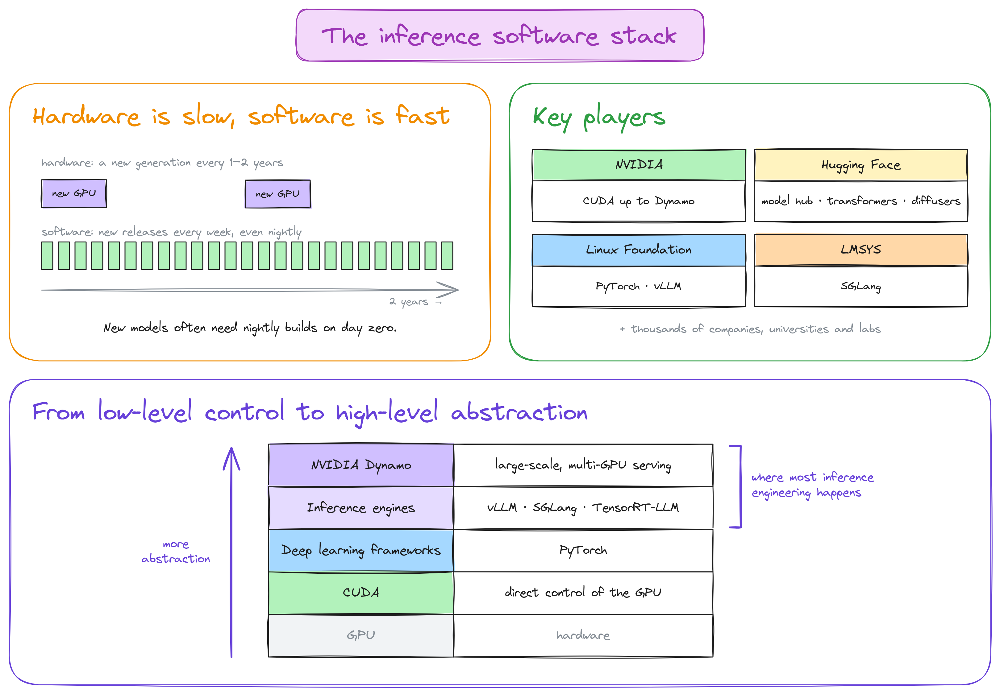

- cuda is nvidia propietary computing platform for executing parallel tasks on gpus. 

- as a developer you don't need to write kernels from scratch all the time.

- nvidia provides different primitive libraries for various purposes: cudnn (deep neural network) and cublas (linear algebra).

- there are also libraries like cute and cutlass, which help you write kernels at a higher level of abstraction while maintaining really strong performance.

- another source of kernels is flashinfer, is a library of high-perf. kernel implementations for inference.

- according to the book, most inference engineers will never need to write kernels. instead, kernel selection, like choosing a plugin from pre-existing kernels, is a key part of the optimization process.

- kernels are hardware specific. a kernel written for an h100 might fail to take advantage of the architecture and extra memory of a b200. in addition, porting handwritten kernels to run optimally on the new architecture might take substantial engineering work.

- if you followed my cuda series, we learned that launching kernels has some overhead, so it is usually better to combine them into a bigger one to reduce that cost. this is called kernel fusion (like in dragon ball... fusionnnn haaaaaa!)

- kernel fusion can be either an automatic or a manual process. compilers can identify straightforward fusion opportunities and automatically create fused kernels.

- but... more sophisticated algorithms like flash attention require a handwritten fused kernels. 

- and for those of us who would rather not debug cuda kernels... there are many deep learning frameworks and libraries that make our life easier.  

- pytorch has emerged as the clear leader at this level of the stack. though there is also tensorflow and jax.

    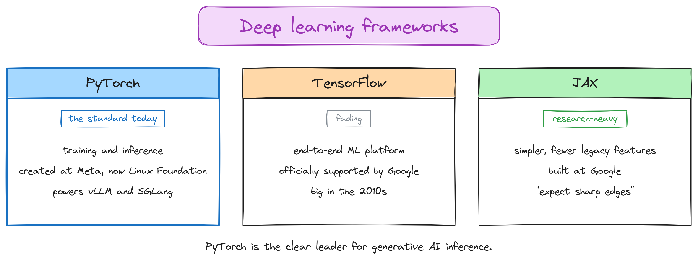

- pytorch lets you work with tensors in python and autograd takes care of calculating gradients for you... (convinient, right?).

- pytorch is useful for inference as well. `torch.compile` can speed things up by selecting kernels for your gpu and fusing operations together.

- safetensors saves model weights without executable python code. 

- onnx includes both the model weights and the execution graph, which describes how the operations connect.

    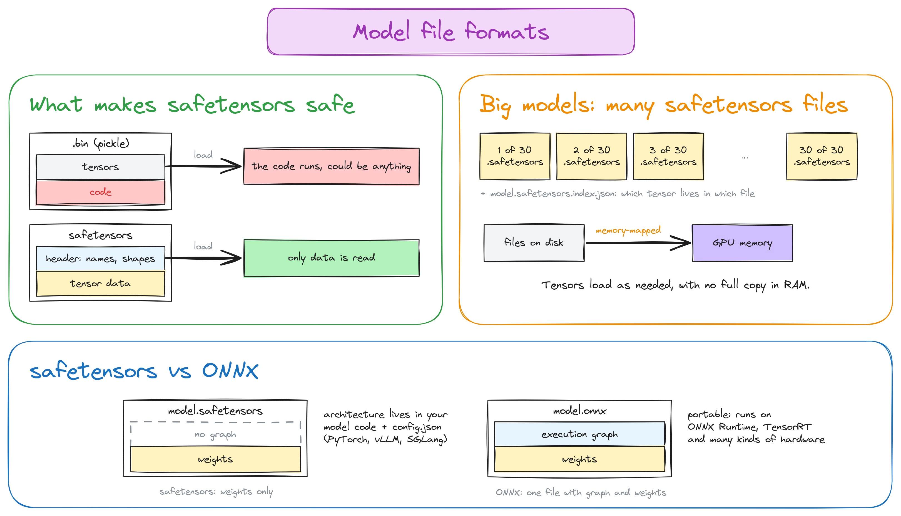

- finally, you can run pytorch models with onnx runtime by exporting them to onnx, or with tensorrt by compiling them with torch-tensorrt. both runtimes are built for fast inference.

- onnx runtime is open source and works across different gpu types. tensorrt only supports nvidia gpus, but works particularly well for image and video workloads.

    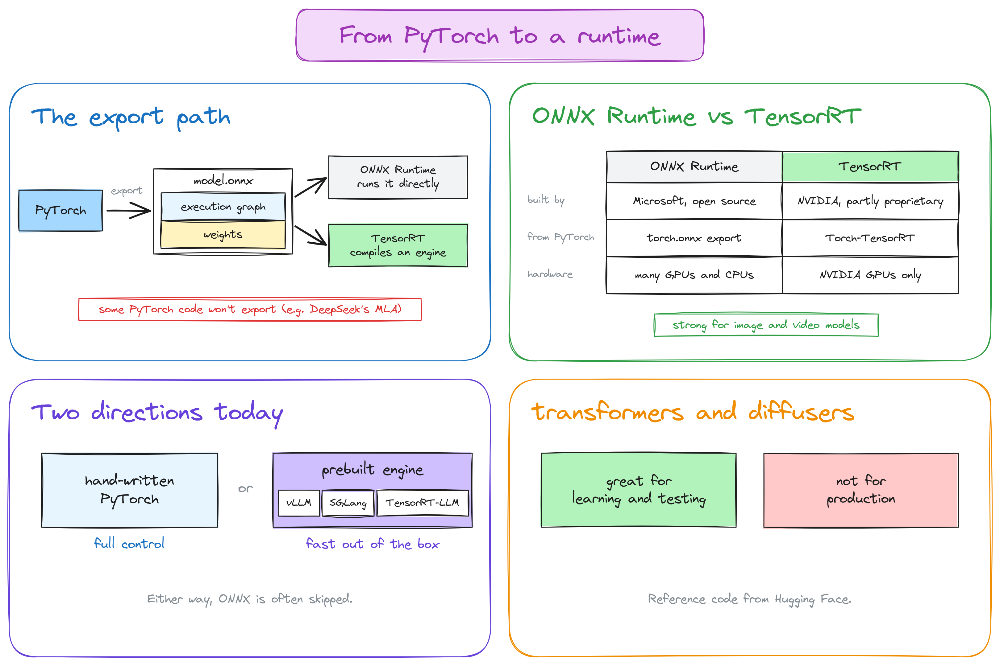

### Day 7

- picking up where i left off yesterday... here are the rest of my notes on chapter 4 of Inference Engineering:

- the book covers three main inference engines: vllm, sglang and tensorrt-llm. which one you pick depends on the model you're running, your hardware and the performance you need.

- vllm is a good place to start since it supports lots of models and hardware. there's also vllm omni for image, audio and video inputs and outputs.

- sglang is another option, especially for large MoE models like deepseek and kimi, which it has optimized implementations for. it also has sglang diffusion for image and video generation.

    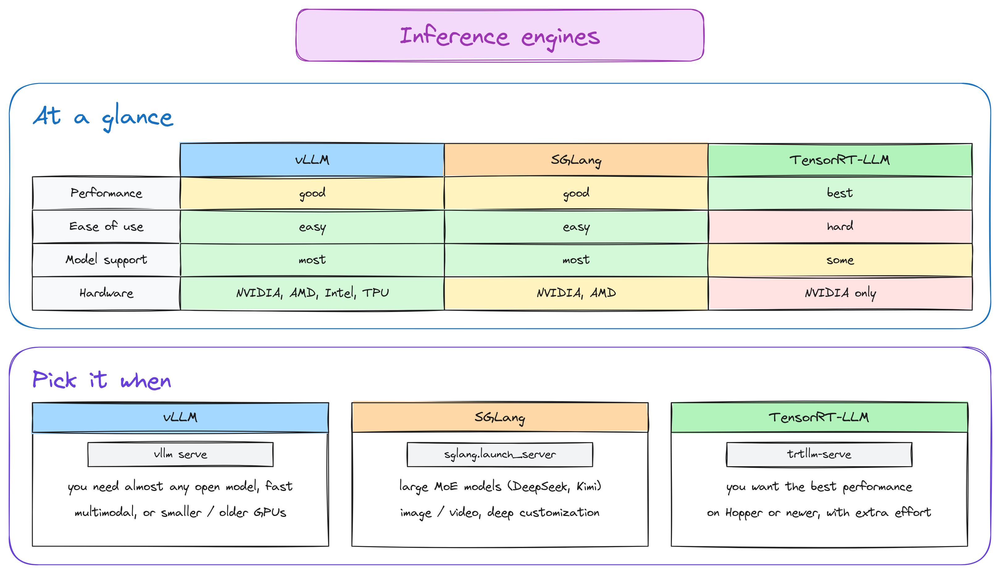

- if you're using nvidia gpus, tensorrt-llm is another option. its kernels are tuned for nvidia hardware and it integrates really well with nvidia dynamo.

- hmm so what is this dynamo thing? nvidia first announced dynamo at gtc in march 2025. it's a distributed system for serving models across multiple machines. 

- dnyamo in a way feels like kubernetes for llm inference, coordinates gpus across multiple machines, routes request, etc.

- dynamo can use any of the three engines mentioned above as a backend: vllm, sglang or tensorrt-llm.

- if you're building an inference api for a foundation model you built from scratch, or serving an open model in a product with lots of traffic, dynamo might be a good option.

- according to the book, for smaller deployments is better to use the inference engines directly (vanilla vllm, ...). dynamo adds complexity and overhead.

    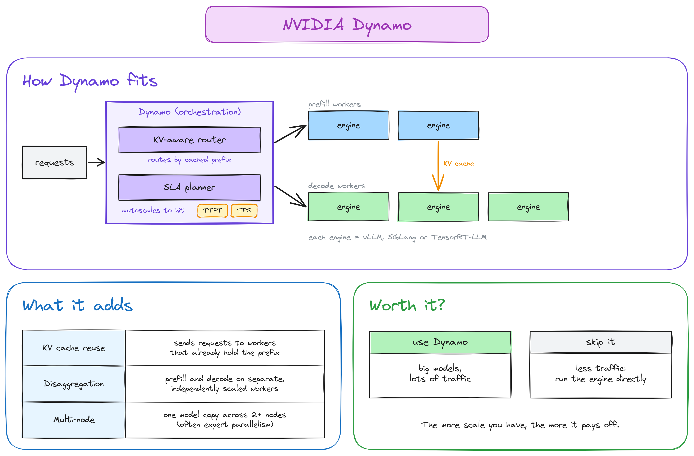

- finally, the last section of chapter 4 focus on benchmarking and profiling.

- to put it in simple terms, benchmarking tells you how "well" your system is perfoming. while profiling tells you why is performing that way.

- benchmarking looks at the bigger picture, metrics like TTFT. profiling is more granular in nature, like how much time a softmax kernel takes to run.

- for benchmarking, you can use tools like sglang genai-bench, nvidia genai-perf, locust. also there are open-source eval datasets such as mmlu, gsm8k, swe-bench, and humaneval to get a realistic performance read.

- for profiling, tools like pytorch profiler, nvidia nsight systems (nsys), nvidia nsight compute (ncu), tensorflow, and tensorrt built-in profilers help you see where time and memory are actually going.

- the book also explained the importance of shadowing to get high-quality benchmark results.

- with shadowing, you send a copy of real production requests to your test system. that way you can benchmarking without affecting your original request.

    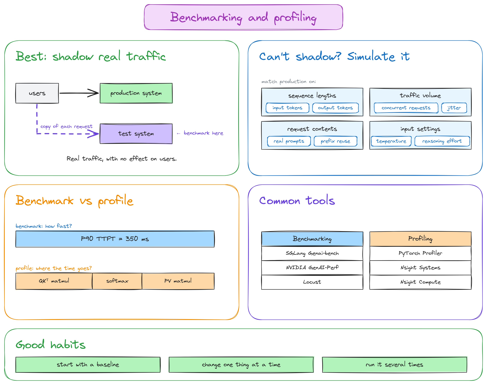

### Day 8

- today i read chapter 5 of Inference Engineering. this chapter is extremely important, it introduces several optimizations: quantization, speculative decoding, caching, model parallelism and disaggregation. 

    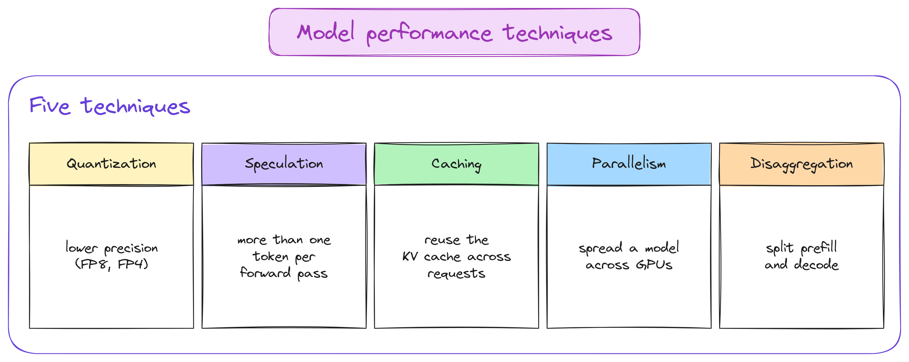

- i'll work on one optimization a day so i can cover as much content as possible. so... let's start with quantization:

- quantization is the process of reducing numerical precision (less bits) of model weights and activations with the goal of lowering memory usage and improve inference speed. 

- quantization improves inference for both prefill and decode. prefill can run lower precision tensor cores with twice the flops. and decode only needs to load half as much data, doubling the memory bandwidth.

    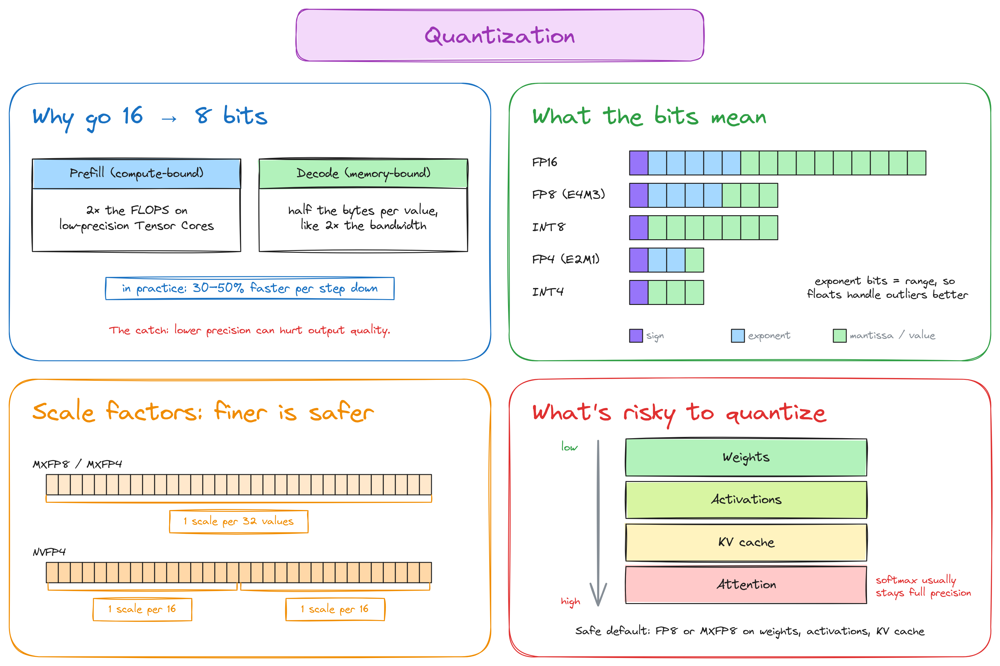

- the book explains that working with quantized data have some overhead, so is not exactly twice as "good", it is usually 30% to 50% better performance for llms.

- one important concept to understand quantization is the "scale factor". you can think of it as a multiplier used during quantization to fit large or small numbers into a lower-precision format, such as fp8 or fp4.

    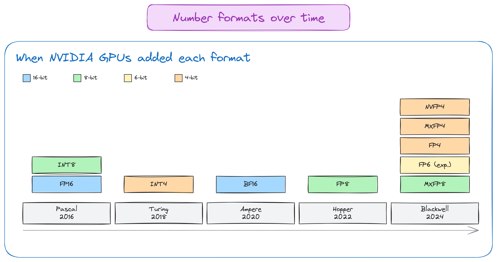

- for example, to store 12 in a format that whose max. value is 6, you can use a scale factor of 2. then keep that scale factor around so you can bring the value back later...

    ```text
    store:        12 / 2 = 6
    reconstruct:   6 × 2 = 12
    ```

- also important is the concept of dynamic range. which is basically how wide the number format's range is. a wider dynamic range means the format can handle both really tiny and really large numbers just fine!

- this is extremely important for quantization because a limited dynamic range can make precision errors more "noticeable".

- a popular tool for post-training quantization is nvidia tensorrt model optimizer (modelopt). its outputs work with all the major inference engines (vllm, sglang, tensorrt-llm).

- gguf is the most popular binary format on hugging face for sharing highly quantized models.

- the book also mentions mxfp8, mxfp4 and nvfp4, which help with dynamic range.

- the book recommends fp8 and mxfp8 as a nice balance between performance and quality. it also mentions fp4, especially nvfp4 as promising...

- for most inference work, you're not quantizing from scratch... you're usually quantizing a model that's already trained. the main choices are which parts to compress and which number format to use.

- finally, after quantizing, you want the quality loss to feel basically zero... so you compare the quantized model against the original.

- there are three techniques for doing this check: perplexity score, intelligence benchmarks, or custom evals that match how you actually use the model.

    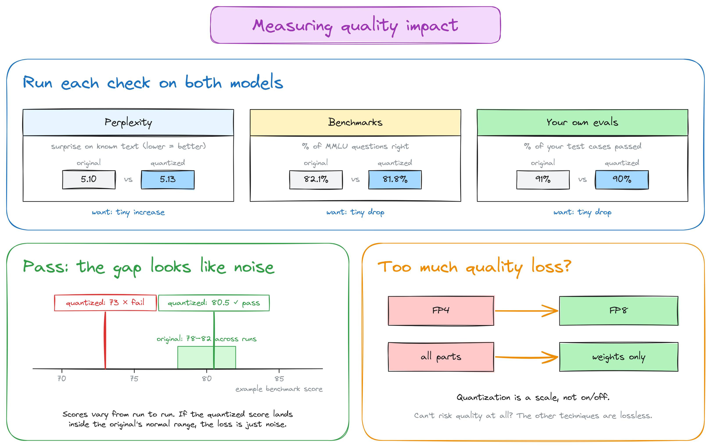

### Day 9

- still on chapter 5 of inference engineering... today we continue with the second optimization, speculative decoding:

- as we saw before, the decode phase generate tokens one at a time, and the main bottleneck is memory bandwidth.

- the idea behind speculative decoding is to use a smaller, faster model to guess a few tokens ahead. then our target model (bigger model), validates those guesses. checking guesses is much cheaper than generating new ones, like checking a sudoku solution instead of solving it.

- so the small model we use to generate token guesses is called the "draft model", or with a bit more "affection", the speculator... :)

- ok... say our target model output so far is "the gpu". the draft model outputs guesses "[executes] [cuda] [kernels] [quickly]".

- now the target model, checks the guesses. since we already have all the draft tokens, it can check all four in one forward pass:

    ```text
    the gpu [executes]                      - accepted
    the gpu executes [cuda]                 - accepted
    the gpu executes cuda [kernels]         - accepted
    the gpu executes cuda kernels [quickly] - rejected
    ```

- now say the target model picks "efficiently" instead of "quickly". we keep the first three guesses and replace the last one: "the gpu executes cuda kernels efficiently".

- so we got four new tokens in one pass of the target model! we still have to pay the price of running the draft model, which is why for this to help the draft model needs to be fast!

    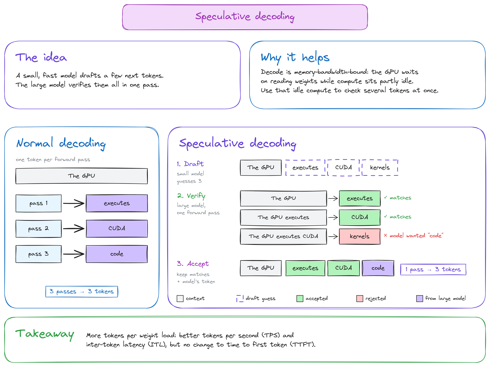

- speculative decoding usually improves tokens per second (TPS) and average inter-token latency (ITL). but no time to first token (TTFT).

- also the performance of speculative decoding depends on the metrics: draft token cost, draft sequence length and token acceptance rate.

- the book explains that one of the most important decisions is which draft model to use. a good draft model has a high token acceptance rate and is not "expensive" to run.

- a few guidelines when picking a draft model: stay in the same model family, keep the draft model at least 10x smaller by param. count, and use fine-tuning or distillation to help it behave more like the target model.

- what we just talked about is "draft-target speculative decoding". the book also explains three other variants: medusa, eagle and n-gram.

- medusa: extra heads added to the target model itself, instead of one decoding head we have multiples. important medusa is not widely use in production.

- eagle: a draft model trained to take hidden states as input and generate speculative tokens as output. eagle is the most common speculation method for general llm serving. it gets a high acceptance rate from a tiny model: less than 1b params.

- n-gram: instead of using any model at all, is basically a loopup table built from text the model has already seen. 

    
    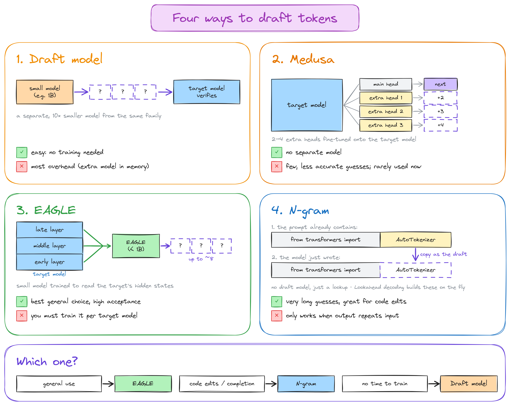