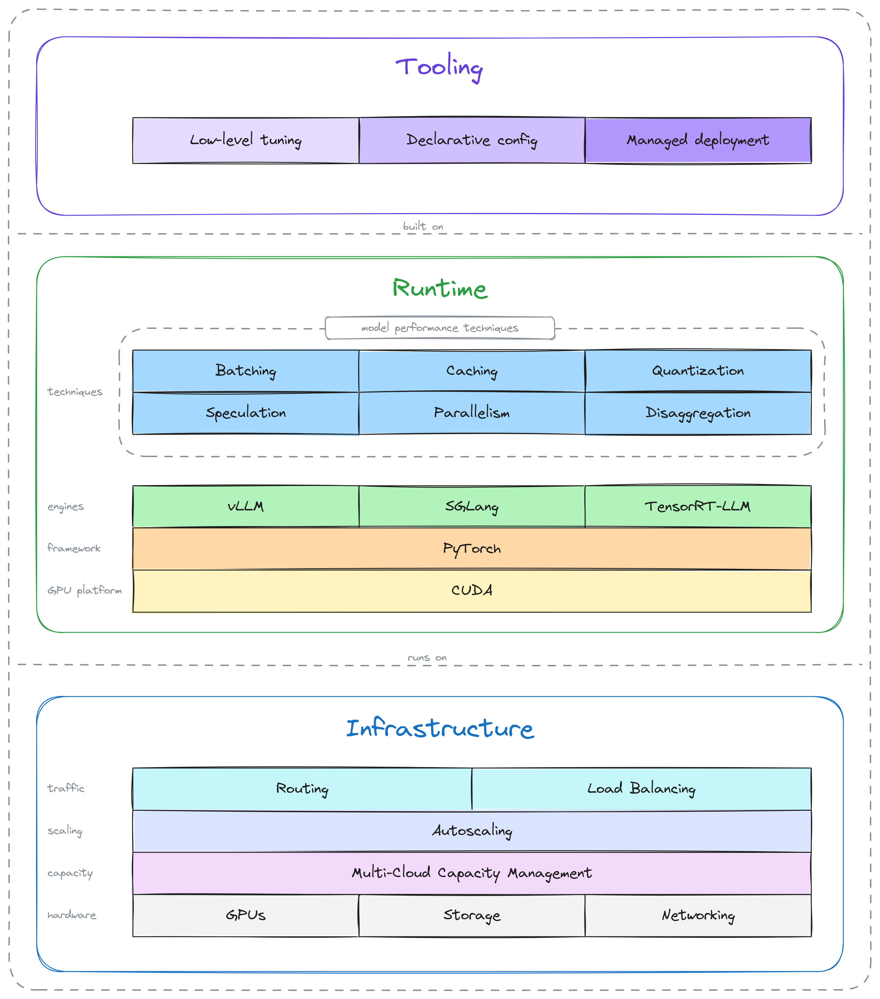
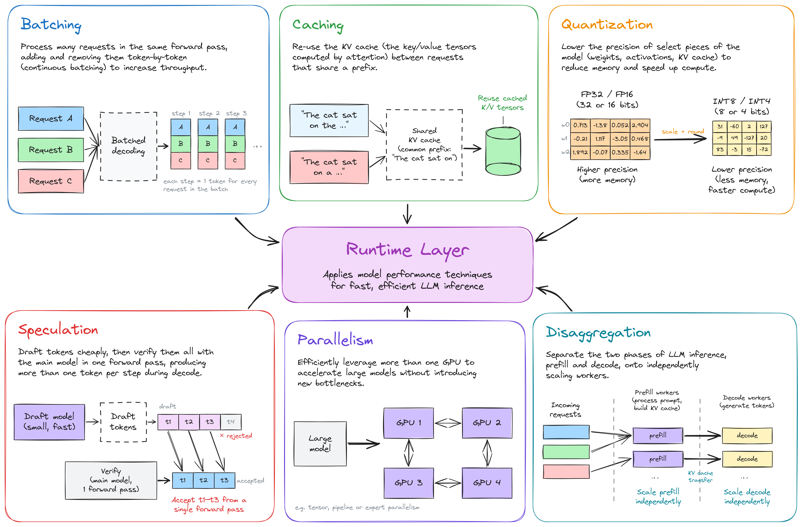
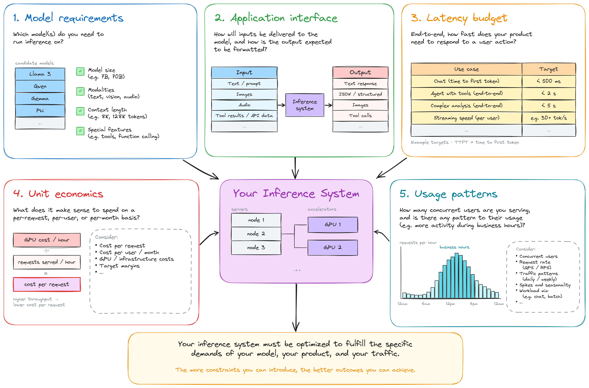
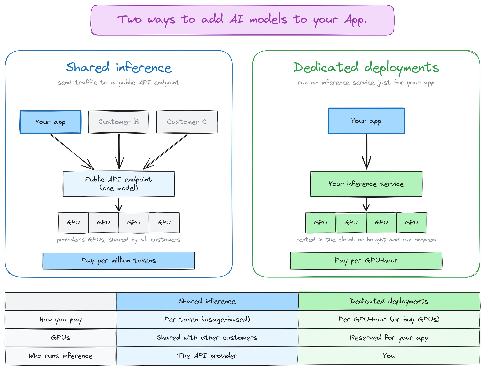
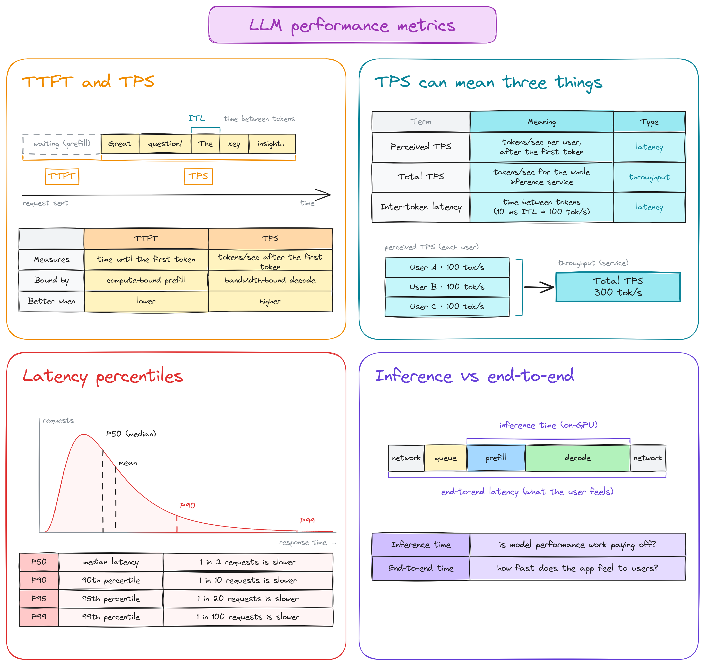

# 100 days of Inference Engineering

### Day 1

- today i read chapter 0 of Inference Engineering. some of the learnings below:

- apparently we have time... inference engineering is still in its infancy. huge potential, still a young field. used to be a pretty niche field (around 3 years ago).

- the book explained a trend starting around 2024 when open models started to catch up with the frontier. you might remember deepseek v3 and r1 crashing ai stocks :)

- since open models are becoming better and better, "many" companies are actively swapping out closed models and fine-tuning open ones for domain specific tasks.

- a production "ready" inference stack have both runtime and infrastructure optimizations, also tools for helping developers deal with the complexity and stay productive...

    

    

### Day 2

- today i read chapter 1 of Inference Engineering. compared to yesterday chapter there is a lot of important stuff on this one, i tried my best to extract the main points. 

- there is not one fit all for inference, an inference services must be specialized for the demands of their workloads. thus it's important to know: model requirements, app. interface, latency budgets, unit economics and usage patterns.

    

- there are two ways to add ai to your app: shared inference or dedicated deployment.

    

- if you're building ai product and you have no idea of your workload will be, start with pay-per-token API, something like OpenRouter (shared inference). 

- one of the most important decisions is which model you choose to work with. smaller models tend to be cheaper and faster to run. so before you go all crazy on speculative decoding keep that in mind... check if a smaller model can get the job done.

- on evals, the book mentioned the ongoing industry benchmark-maxxing that is going on and how those tests are being gamed to make a model looks good... also on the importance of having application evals tailor to your app. the latter is a must have!

- the book defines fine-tuning as taking a foundation model and re-targeting it to different use case. fine-tuning benefits from tasks when the scope is small, for example text2sql. important fine-tuning does not changes the model architecture only the weights.

- destillation on the otherhand preserves the behavior of a large model in a smaller, more efficient model, and thus changes the architecture. 

- learned a bunch of metrics: time to first token (TTFT), perceived and total tokens per second (TPS), iter-token latency (ITL), also the important of consider latency percentiles while measuring those.

    